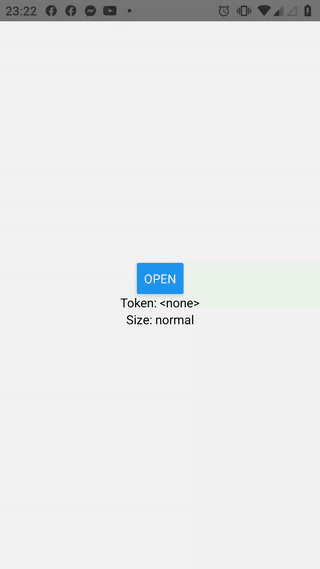
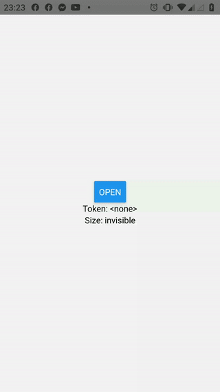

<p align="center">
  
  <br>
  <sub>A dependable Google reCAPTCHA v2 and Enterprise bridge for React Native and Expo that works.</sub>
</p>

<p align="center">
  <b>React Native reCAPTCHA That Works</b> provides a robust, seamless bridge to run Google reCAPTCHA (v2 Checkbox, v2 Invisible, and Enterprise) inside React Native applications. Works out of the box with bare React Native and Expo via a performant WebView modal dialog.
</p>

<p align="center">
  <sub>Looking for the React DOM version? Check out <a href="https://github.com/douglasjunior/react-recaptcha-that-works"><b>react-recaptcha-that-works</b></a>.</sub>
</p>

<p align="center">
  <a href="LICENSE"></a>
  <a href="https://www.npmjs.com/package/react-native-recaptcha-that-works"></a>
  <a href="https://www.npmjs.com/package/react-native-recaptcha-that-works"></a>
  
  
  
  <a href="https://github.com/douglasjunior/react-native-recaptcha-that-works/pulls"></a>
</p>

<p align="center">
  <a href="#-quick-start"><b>Quick Start</b></a> ·
  <a href="#-why-recaptcha-that-works">Why</a> ·
  <a href="#-previews">Previews</a> ·
  <a href="#-installation">Installation</a> ·
  <a href="#-usage">Usage</a> ·
  <a href="#-props">Props</a> ·
  <a href="#-methods">Methods</a> ·
  <a href="#-official-documentation">Docs</a> ·
  <a href="#-troubleshooting">Troubleshooting</a> ·
  <a href="#-contributing">Contributing</a>
</p>

---

> [!IMPORTANT]
> ### 🚨 Important Notice Regarding WebView vs Native Enterprise
>
> Users have observed an increase in "high risk requests" when using WebView-based reCAPTCHA solutions on mobile platforms. Official Google documentation advises evaluating whether native SDKs or WebView approaches best fit your threat model on iOS and Android.
>
> Google now offers a [first-party solution for React Native](https://github.com/GoogleCloudPlatform/recaptcha-enterprise-react-native/) intended for Enterprise use. We encourage you to test both this WebView-based solution and Google's first-party native library to determine which best fits your application's requirements.
>
> For full details and ongoing community discussions, see [Issue #67](https://github.com/douglasjunior/react-native-recaptcha-that-works/issues/67#issuecomment-2604329675).

---

## 🚀 Quick Start

```bash
# 1. Install package and peer dependency
yarn add react-native-recaptcha-that-works react-native-webview
# or: npm i -S react-native-recaptcha-that-works react-native-webview
```

```tsx
import React, { useRef } from 'react';
import { View, Button } from 'react-native';
import Recaptcha, { RecaptchaRef } from 'react-native-recaptcha-that-works';

export default function App() {
  const recaptcha = useRef<RecaptchaRef | null>(null);

  const handleOpen = () => {
    recaptcha.current?.open();
  };

  const handleVerify = (token: string) => {
    console.log('Verified token:', token);
  };

  const handleExpire = () => {
    console.warn('reCAPTCHA expired');
  };

  return (
    <View style={{ flex: 1, justifyContent: 'center', alignItems: 'center' }}>
      <Button title="Verify Security" onPress={handleOpen} />

      <Recaptcha
        ref={recaptcha}
        siteKey="<your-recaptcha-public-key>"
        baseUrl="http://my.domain.com"
        onVerify={handleVerify}
        onExpire={handleExpire}
        size="invisible"
      />
    </View>
  );
}
```

---

## 💡 Why reCAPTCHA That Works?

- ⚛️ **Expo & Bare React Native Compatible:** Seamlessly runs on managed Expo workflows and bare React Native applications without native pod linking or compilation headaches.
- 🛡️ **reCAPTCHA v2 (Normal & Invisible):** Full support for interactive checkbox widgets, compact layouts, and background challenges triggered on demand.
- 🏢 **Enterprise API Support:** Native support for Google Cloud reCAPTCHA Enterprise endpoints via the `enterprise` flag, custom `action` tagging, and domain overrides.
- 🪟 **Fully Customizable Modal:** Tailor background styles, integrate custom `headerComponent`, `footerComponent`, and swap in your own custom `loadingComponent`.
- 🌍 **Automatic Device Localization:** Automatically inherits the device's system language, or accepts any official Google reCAPTCHA [language code](https://developers.google.com/recaptcha/docs/language) via `lang`.
- 🔒 **Lightweight & Dependable Bridge:** Leverages the battle-tested `react-native-webview` engine with isolated communications and normalized error handling.
- 📘 **TypeScript Ready:** Shipped with strict TypeScript definitions for both component props (`RecaptchaProps`) and imperative refs (`RecaptchaRef`).

---

## 📸 Previews

| Normal Checkbox | Invisible Challenge |
|:---:|:---:|
|  |  |

<p align="center">
  🎮 Try the interactive <a href="https://snack.expo.dev/@douglasjunior/react-native-recaptcha-that-works"><b>Online Expo Snack Demo</b></a> directly in your browser or phone.
</p>

---

## 📦 Installation

Install `react-native-recaptcha-that-works` together with its peer dependency [`react-native-webview`](https://github.com/react-native-webview/react-native-webview):

Using **yarn**:
```bash
yarn add react-native-recaptcha-that-works react-native-webview
```

Using **npm**:
```bash
npm i -S react-native-recaptcha-that-works react-native-webview
```

> [!NOTE]
> If you are on a bare React Native project (non-Expo), remember to complete the iOS pod installation:
> ```bash
> cd ios && pod install
> ```
> For additional native setup instructions, refer to the [`react-native-webview` Getting Started Guide](https://github.com/react-native-webview/react-native-webview/blob/master/docs/Getting-Started.md).

---

## 💻 Usage

### With TypeScript

```tsx
import React, { useRef } from 'react';
import { View, Button, StyleSheet } from 'react-native';
import Recaptcha, { RecaptchaRef } from 'react-native-recaptcha-that-works';

export const SecurityScreen: React.FC = () => {
  const recaptcha = useRef<RecaptchaRef | null>(null);

  const handleSend = () => {
    console.log('Opening reCAPTCHA challenge...');
    recaptcha.current?.open();
  };

  const handleVerify = (token: string) => {
    console.log('reCAPTCHA successfully verified! Token:', token);
  };

  const handleExpire = () => {
    console.warn('reCAPTCHA token expired!');
  };

  const handleError = (error: any) => {
    console.error('reCAPTCHA error:', error);
  };

  const handleClose = () => {
    console.log('reCAPTCHA modal dismissed');
  };

  return (
    <View style={styles.container}>
      <Recaptcha
        ref={recaptcha}
        siteKey="<your-recaptcha-public-key>"
        baseUrl="http://my.domain.com"
        onVerify={handleVerify}
        onExpire={handleExpire}
        onError={handleError}
        onClose={handleClose}
        size="invisible"
        theme="light"
      />
      <Button title="Submit Form" onPress={handleSend} />
    </View>
  );
};

const styles = StyleSheet.create({
  container: {
    flex: 1,
    justifyContent: 'center',
    alignItems: 'center',
  },
});
```

<details>
<summary><b>Or with plain JavaScript:</b></summary>

```jsx
import React, { useRef } from 'react';
import { View, Button } from 'react-native';
import Recaptcha from 'react-native-recaptcha-that-works';

const App = () => {
  const recaptcha = useRef(null);

  const send = () => {
    console.log('Opening reCAPTCHA challenge...');
    recaptcha.current.open();
  };

  const onVerify = (token) => {
    console.log('Success token:', token);
  };

  const onExpire = () => {
    console.warn('Expired!');
  };

  return (
    <View style={{ flex: 1, justifyContent: 'center', alignItems: 'center' }}>
      <Recaptcha
        ref={recaptcha}
        siteKey="<your-recaptcha-public-key>"
        baseUrl="http://my.domain.com"
        onVerify={onVerify}
        onExpire={onExpire}
        size="invisible"
      />
      <Button title="Send" onPress={send} />
    </View>
  );
};

export default App;
```
</details>

For a complete working implementation, see the [Sample Project](https://github.com/douglasjunior/react-native-recaptcha-that-works/blob/master/Sample/App.tsx).

---

## 🎛️ Props

| Prop | Type | Default | Description |
|---|---|---|---|
| `siteKey` | `string` | _(Required)_ | Your Web reCAPTCHA site key. (Must use the Web key, not native Android key). |
| `baseUrl` | `string` | _(Required)_ | The domain URL configured in Google reCAPTCHA Console (e.g. `http://my.domain.com`). See [Issue #34](https://github.com/douglasjunior/react-native-recaptcha-that-works/issues/34). |
| `onVerify` | `(token: string) => void` | _(Required)_ | Callback executed when user submits a successful response. Delivers the verified token string. |
| `size` | `'invisible'` \| `'normal'` \| `'compact'` | `'normal'` | Size mode of the reCAPTCHA widget. |
| `theme` | `'dark'` \| `'light'` | `'light'` | Color theme of the widget. |
| `lang` | `string` | _device locale_ | [Google Language Code](https://developers.google.com/recaptcha/docs/language). Defaults to device language if omitted. |
| `onLoad` | `() => void` | | Callback executed when reCAPTCHA finishes loading and is ready. |
| `onExpire` | `() => void` | | Callback executed when the reCAPTCHA token expires and requires re-verification. |
| `onError` | `(error: any) => void` | | Callback executed when reCAPTCHA encounters a network or runtime error. |
| `onClose` | `() => void` | | Callback executed when the Modal dialog is dismissed. |
| `headerComponent` | `ReactNode` | | Custom component to render at the top of the Modal. |
| `footerComponent` | `ReactNode` | | Custom component to render at the bottom of the Modal. |
| `loadingComponent` | `ReactNode` | | Custom component rendered while the reCAPTCHA WebView is loading. |
| `style` | [`StyleProp<ViewStyle>`](https://reactnative.dev/docs/view-style-props) | | Customize style properties of the modal container, such as background color. |
| `modalProps` | [`ModalProps`](https://reactnative.dev/docs/modal) | | Override properties passed to the underlying React Native `Modal`. |
| `webViewProps` | [`WebViewProps`](https://github.com/react-native-webview/react-native-webview/blob/master/docs/Reference.md) | | Override properties passed to the underlying `WebView`. |
| `recaptchaDomain` | `string` | `'www.google.com'` | Hostname for the valid reCAPTCHA API. See [Google global API details](https://developers.google.com/recaptcha/docs/faq#can-i-use-recaptcha-globally). |
| `gstaticDomain` | `string` | `'www.gstatic.com'` | Custom host name for reCAPTCHA `gstatic` resources. |
| `hideBadge` | `boolean` | `false` | When `size="invisible"`, allows hiding the badge as long as reCAPTCHA branding is visibly included. See [Google Branding FAQ](https://developers.google.com/recaptcha/docs/faq#id-like-to-hide-the-recaptcha-badge.-what-is-allowed). |
| `enterprise` | `boolean` | `false` | Enable the [reCAPTCHA Enterprise API](https://cloud.google.com/recaptcha-enterprise/docs/using-features). For Enterprise, choose `size` when creating the site key. See [Issue #55](https://github.com/douglasjunior/react-native-recaptcha-that-works/issues/55#issuecomment-2107089307). |
| `action` | `string` | | Action name associated with protected elements for the reCAPTCHA Enterprise API. See [Enterprise Actions](https://cloud.google.com/recaptcha-enterprise/docs/actions). |

---

## 🛠️ Methods

Imperative methods exposed via the `ref` handle (`RecaptchaRef`):

| Method | Type | Description |
|---|---|---|
| `open()` | `() => void` | Opens the reCAPTCHA Modal. When using `size="invisible"`, the security challenge runs automatically. |
| `close()` | `() => void` | Closes and dismisses the reCAPTCHA Modal. |

---

## 📚 Official Documentation

- **Google reCAPTCHA v2:**
  - [Checkbox ("I'm not a robot") Documentation](https://developers.google.com/recaptcha/docs/display)
  - [Invisible reCAPTCHA Documentation](https://developers.google.com/recaptcha/docs/invisible)
- **Google reCAPTCHA Enterprise:**
  - [Enterprise Overview](https://cloud.google.com/recaptcha-enterprise/docs/)
  - [Using Enterprise Features](https://cloud.google.com/recaptcha-enterprise/docs/using-features)

---

## 🔍 Troubleshooting

### 1. WebView Not Loading on iOS

If the WebView hangs or refuses to load reCAPTCHA on iOS, this is often caused by known upstream behaviors in `react-native-webview`:

**Related Issues:**
- [Issue #65: iOS WebView Blank Screen](https://github.com/douglasjunior/react-native-recaptcha-that-works/issues/65)
- [Issue #69: WebView Loading Failures](https://github.com/douglasjunior/react-native-recaptcha-that-works/issues/69)

**Upstream Pull Requests:**
- [react-native-webview PR #3615](https://github.com/react-native-webview/react-native-webview/pull/3615)
- [react-native-webview PR #3880](https://github.com/react-native-webview/react-native-webview/pull/3880)

---

### 2. Invalid `siteKey` or `baseUrl`

This package utilizes the **Web version of reCAPTCHA v2**. You must configure your project with the **Site Key** generated for Web applications, rather than an Android SDK key:

<p align="center">
  
</p>

> [!TIP]
> You can create a new reCAPTCHA v2 key at the [Google reCAPTCHA Admin Console](https://www.google.com/recaptcha/admin/create).

Additionally, the `baseUrl` prop must match an authorized domain listed in the **Domains** section of your Google reCAPTCHA Console:

<p align="center">
  
</p>

```tsx
<Recaptcha
  siteKey="your-web-public-key"
  baseUrl="http://mysite.com"
  onVerify={handleVerify}
/>
```

---

## 🤝 Contributing

Contributions, issues, and feature requests are welcome!

1. Fork the repository and create your topic branch (`git checkout -b feature/my-feature`).
2. Verify code quality and types with `npm run build`.
3. Follow [Conventional Commits](https://www.conventionalcommits.org/) for all commit messages.
4. Submit a pull request describing your improvements.

For bug reports or questions, feel free to open an [issue](https://github.com/douglasjunior/react-native-recaptcha-that-works/issues).

### Support the Author

If this library saves you time and protects your app against bots, consider supporting the maintainer:

<p align="left">
  <a href="https://www.patreon.com/douglasjunior"></a>
  &nbsp;
  <a href="https://paypal.me/douglasnassif"></a>
</p>

---

## ⭐ Star History

<p align="center">
  <a href="https://star-history.com/#douglasjunior/react-native-recaptcha-that-works&Date">
    <picture>
      <source media="(prefers-color-scheme: dark)" srcset="https://api.star-history.com/svg?repos=douglasjunior/react-native-recaptcha-that-works&type=Date&theme=dark" />
      
    </picture>
  </a>
</p>

---

## 📄 License

```text
The MIT License (MIT)

Copyright (c) 2020 Douglas Nassif Roma Junior
```

See the full [license file](LICENSE).

---

## 🌐 Author & More Projects

<p align="center">
  <a href="https://douglasjunior.work">
    
  </a>
</p>

<p align="center">
  Discover more open-source libraries, creative animation engines, and developer tools at <a href="https://douglasjunior.work"><b>douglasjunior.work</b></a>.
</p>
